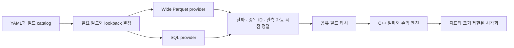

# longshort_platform 재검토: DB 연결, 동적 유니버스, AFL

확인일 2026-09-09. 기존 리뷰와 소스, 팀 캐시 및 생성 코드를 대조했다. 제품 소스·기존 리뷰·설정은 수정하지 않았다. 이번 산출물은 이 문서와 `review_2026-09-09/`에만 추가했다.

결론: **C++가 기존 wide Parquet를 직접 읽는 provider를 우선 구현하고, 원천 SQL provider가 같은 데이터 계약을 채우도록 설계하는 것이 적합하다.** Python에서 long Parquet를 새로 만드는 과정은 필수 구성요소가 아니다. 이미 C++ Parquet 로더가 있으며, 지금 필요한 것은 다중 데이터셋·선택 로딩·일별 유니버스·필드별 시간축 지원이다. Python은 데이터 탐색과 팀 StatsHandler 대조에 계속 유용하다.

## 1. 검증 범위

- 저장소: `/home/jgo/longshort_platform`, 기존 tracked 파일 변경 없음.
- 원본 `simulator.cpp`, `expr_parser.cpp`, `data_panel.cpp`, `parquet_reader.cpp`, 시계열 모듈을 독립 실행 파일로 컴파일하여 재현했다. 로컬 PyArrow 18.1.0의 `OpenFile` API 차이만 재현용 헤더로 연결했으며, 계산·변환 로직은 원본이다.
- GA는 원본 `ga_engine.cpp`, `search_space.cpp`, `parallel_evaluator.cpp`를 UBSan으로 컴파일했다. 파서는 사용하지 않고 작은 SearchSpace를 직접 만들었다. 사용하지 않는 XML 파서 함수는 linker garbage collection으로 제외했다.
- 전체 CMake 구성은 실패했다. CMake 3.28.3은 `CMP0167`을 모르고, Arrow CMake package도 없다. HTTP 서버·전체 CTest·브라우저 테스트가 통과했다는 의미는 아니다.
- 프론트는 정적 검증. `node_modules`, `frontend/lib/` 6개 모듈, 삭제된 Python 픽스처가 없다.
- AFL 파일 개수·용량은 디렉터리 전체에서 집계했다. 날짜·스키마는 폴더별 3개 팩터(100, 464, 1005), 총 6개 파일을 표본 검사했다. 600개 전체를 메모리에 올리지 않았다.
- 원천 SQL은 팀 수집 코드만 읽었다. DB 연결·쿼리 실행·실행계획·서버 성능 측정은 하지 않았다.

근거: [엔진 재현 결과](review_2026-09-09/engine_probe_results.json), [GA 재현 결과](review_2026-09-09/ga_probe_results.json), [AFL 실측](review_2026-09-09/afl_inventory.json).

## 2. 기존 리뷰 재검증 및 수정할 해석

| 기존 항목 | 재검토 결과 |
|---|---|
| 종가 체결 가정으로 trading leg 없음 | 맞음. `simulator.cpp:79-94`는 보유 수익과 거래비용만 계산한다. 팀의 다른 체결가 규약으로 옮길 때 기능 확장이 필요하다. 누락 버그로 단정할 항목은 아니다. |
| `delay=1` + mode=1 | 맞음. `alphaStore.ts:78`, `dag_builder.cpp:259-271`, `simulator.cpp:76,115-120`. 팀 규약과 비교하면 추가 정보 지연이 생긴다. 사용자 지정 지연 자체는 유효한 전략 선택이므로 실행 지연과 구분해서 표시해야 한다. |
| 모듈 재실행 시 상태 오염 | C++ 재현 확인. 동일 입력 `1,2,3,4`, tsmean(2)의 첫 실행은 `NaN,1.5,2.5,3.5`, 재실행은 `NaN,2.5,3,3.5`. `main.cpp:396`에서 실행한 객체를 `:467`에서 다시 쓴다. |
| minBet 항목 — 사용자 정의 확인 후 정정 | 화면 `avgBet`=평균 보유 종목 수, `minBet`=기간 중 최소 보유 종목 수가 의도한 정의이며 현재 계산·표시는 맞다. 계산 오류 분류를 철회한다. 문제는 예전 계약 문서와 내부/API 이름의 혼동이었고 `math_contract.md`를 종목 수 정의로 수정했다. |
| combined raw 합산·비결정성 | 코드상 확인. `main.cpp:375-384`의 mutex는 데이터 경쟁을 막지만 합산 순서를 고정하지 않는다. 정규화 없는 raw 합산은 현재 동작이며, 동일가중 결합을 제품 계약으로 원한다면 바꿔야 한다. |
| close 결측 시 손익 소실 | C++ 재현 확인. 아래 R1의 연결 설계 문제와 직접 이어진다. |
| frontend/lib 누락·픽스처 부재 | git 및 실제 파일에서 확인. `.gitignore:17`의 `lib/` 규칙이 적용되고 `api.ts`만 tracked 상태다. |
| Drawdown·멀티알파 시그널·simStart | 코드상 확인. `DetailTimeSeries.tsx:111`은 ratio drawdown, `api.ts:194`는 top-level signalPlot만 읽고 `:224`는 collectSignals를 보내지 않는다. simStart는 시뮬레이션 기간을 자르지 않는다. |
| 365 하드코딩 | 맞음. 365→252일 때 Sharpe는 `sqrt(252/365)=0.831`배, 연환산 단리수익률은 `252/365=0.690`배다. 두 지표에 같은 제곱근 배율을 적용하면 안 된다. |

기존 rev5 등 실데이터 Sharpe 실험 전체는 이번에 재실행하지 않았다. 9월 8일 결과를 새로운 실측으로 재표기하지 않는다.

## 3. 추가 발견

### R1 — P1: close를 유니버스 마스크로 쓰는 1단계 설계는 성과 검증에 부적합

근거: 기존 `data_connection_design.md` §5.1–5.2, `simulator.cpp:58-84`.

종목 A를 50% 롱으로 보유한 날 가격이 100→50이고 그날 유니버스에서 빠진다고 하자. 실제 가격을 유지하면 해당 포트폴리오 수익은 **−25%**, close를 NaN으로 덮으면 **0%**가 된다. 독립 C++ 실행으로 확인했다. 이탈 당일과 다음 날 수익률 계산에 필요한 가격 연결이 끊긴다.

가격/holding return은 투자 가능 여부와 별개로 보존해야 한다. `universe_mask`, `signal_valid`, `can_trade`, `valuation_valid`의 역할을 구분한다. 유니버스 이탈, 일시 거래정지, 상폐는 동일한 청산 사건이 아니다. 이탈 시 처리 규칙과 실제 청산 가능 여부가 필요하다. `hr/tr` 역시 당일 유니버스 마스크만으로 지우면 보유분/청산분 손익이 누락된다.

따라서 “C++ 무변경 long 변환으로 먼저 팀 parity 확인”은 수정할 필요가 있다. 데이터가 읽히는지 확인하는 용도로는 가능하지만, 그 결과를 정상적인 성과로 검증하는 단계로 사용할 수 없다.

### R2 — P1: 시계열 연산 후 유니버스 밖 값이 살아나 횡단면 정규화에 섞임

근거: `modules/TsMean.h:22-36`, `modules/Zscore.h:11-35`, `modules/Rank.h:12-20`, `simulator.cpp:48-70`.

첫날 `[10,20,100]`, 다음날 세 번째 종목이 제외되어 `[10,20,NaN]`이면 tsmean(2)는 `[10,20,100]`을 만든다. 이 값으로 zscore를 계산하면 활동 종목 두 개가 모두 음수가 된다. 마지막에 close 유한성으로 세 번째 종목을 제거해도 이미 평균이 오염되어 활동 북의 순노출이 **−100%**가 된다. 유니버스 내부에서만 zscore를 계산하면 두 종목은 반대 부호가 된다. C++ 재현 확인.

원천 데이터를 미리 NaN으로 덮는 것만으로 해결되지 않는다. rank/zscore 같은 횡단면 연산 시점에 유니버스 마스크를 적용하고, 최종 포지션 생성 시에도 적용해야 한다. 시계열 lookback에는 해당 시점에 관측 가능했던 원천 이력을 유지한다.

### R3 — P1: DB에서 흔한 타입과 중복 키를 잘못 처리

근거: `parquet_reader.cpp:95,161,193-210`.

- DOUBLE/INT64 이외의 모든 값 타입을 FloatArray로 static_cast한다. 실제 int32 close=50 입력이 **`7.006492322e-44`**로 읽혔다. BOOL/DECIMAL 등도 지원 여부를 검사해야 한다.
- 시간은 Int64Array로 무검사 캐스트한다. `timestamp[ns]`의 2024-01-01을 넣으면 `1704067200000000000`을 epoch_ms로 취급한다. 단위가 100만 배 틀린다. Date32/nullable time도 명시적 처리 필요.
- `(timestamp,symbol)` 중복 검증이 없어 마지막 행이 덮어쓴다. 가격 `[100,50]`과 같은 행을 역순으로 저장한 파일의 결과가 각각 50과 100이었다.
- null symbol은 빈 문자열 종목으로 들어가고, null timestamp는 유효성 검사 없이 읽는다.

provider 공통 경계에서 schema/type/null/키 유일성을 검증하고 명시적으로 변환한다. 중복 레코드는 조용히 평균/마지막 값으로 선택하지 말고, revision/available_at 등 결정 규칙이 있을 때만 해소한다.

### R4 — P1: 숫자 AFL 팩터 이름이 상수가 됨

근거: `expr_parser.cpp:35-40,160-175`.

실제 AFL 파일 이름은 `100.parquet`, `1005.parquet` 같은 숫자다. 패널에 `1005` 필드를 추가해도 `<data expr="1005"/>`는 모든 종목에 1005를 출력한다. C++에서 필드 값 `[7,8]` 대신 `[1005,1005]`가 나오는 것을 확인했다.

`afl_1005`처럼 숫자로 시작하지 않는 별칭을 catalog에 등록하고 파서가 등록된 필드를 해석하도록 확장한다. 현재 whitelist도 OHLCV뿐이다. `returns`는 이미 close 비율을 계산하는 예약어이므로 팀 holding return에는 `hr` 같은 별도 이름을 사용한다.

### R5 — P1: YAML 선택이 실제 읽기량/실행 범위를 제한하지 못함

근거: `config_loader.cpp:15,35-37`, `main.cpp:122-126`, `parquet_reader.cpp:49-51`.

- `datasets[0]`만 처리한다. universe는 파싱조차 하지 않는다.
- start_date/end_date는 문자열로 읽고 사용하지 않는다. 특히 end_date 뒤 데이터를 성과 평가에 포함할 수 있다.
- `use_col`은 최종 패널에 남길 필드만 제한한다. `ReadTable(&table)`로 먼저 파일 전체를 해제압축한다. 600필드 long 파일에서 10개만 요청해도 600개가 읽힌다.

스키마를 먼저 읽고 필요한 컬럼만 projection하여 batch로 채운다. 데이터 로딩 시작일(lookback)과 성과 평가 시작일을 분리한다. 요청/설정에 지원하지 않는 키가 있으면 조용히 무시하지 말고 오류를 반환한다.

### R6 — P1: GA 개체수 0에서 잘못된 메모리 접근

근거: `main.cpp:673,762`, `ga_engine.cpp:132,153-158`.

유전자가 있는 XML과 `popSize=0`, generations≥1이면 빈 fitness 벡터의 0번 원소를 읽는다. UBSan 실행에서 null pointer reference 오류를 확인했다. 일반 빌드에서는 프로세스 종료를 포함한 undefined behavior가 가능하며 C++ 예외 처리로 복구되지 않는다. UI의 최소값 제한만으로 API 입력을 보호할 수 없다.

API 및 GAConfig 경계에서 population/generations/threads 상하한을 검증한다. generations=0의 완료 응답도 명확히 정의해야 한다.

### R7 — P1(연결 시): AFL 캐시의 갱신일·주기·축이 서로 다름

근거: [afl_inventory.json](review_2026-09-09/afl_inventory.json), 팀 `AflData_uss_v1.py:83-96`, `vendor/uss/save_daily_uss_afl_data.py:36-61`.

- AflData 표본 3개는 2025-03-11까지, AflData_M 표본은 2026-08-28 또는 29까지다. 두 폴더 METADATA는 모두 EndTs=2025-02-23/Freq=1D라 실제 파일과 불일치한다.
- 표본 날짜 간격 중앙값은 31일. AflData는 순수 일별도 순수 월별도 아닌 날짜축이어서 전체 파일명/메타데이터만으로 주기를 확정하면 안 된다.
- AflData_M의 100/464는 50,148종목, 1005는 49,303종목이고 시작일도 다르다. 같은 폴더 내 팩터끼리도 행·열 위치가 동일하다는 보장이 없다.
- AflData 표본은 Top500 기간 합집합에서 5개, Top1000에서 18개 종목 컬럼이 없다. AflData_M 표본에서는 이 누락이 없었다. 컬럼 존재는 유효 값의 실제 coverage와 다르다.
- AflData_M/100의 마지막 날짜는 토요일 2026-08-29다. 가격 거래일과 inner join하면 해당 관측을 버릴 수 있다.

가격 거래일을 기준축으로 두고, 팩터별 ID 정렬과 available_at 기준 backward as-of 접근이 필요하다. 과거 구간으로 bfill하거나 미래 월말 관측을 월초에 붙이면 안 된다. vendor SQL의 asofdate가 실제로 언제 알려진 값인지, 수정 이력을 제공하는지는 이번 검사로 확정하지 못했다. PIT라고 단정할 근거가 없으며 이 규약을 확인해야 한다. 최신 월별 캐시라는 이유만으로 일별 AFL의 대체재로 선택해서도 안 된다.

### R8 — P2: 취소 후 계산 지속, 멀티알파 전체의 상태 버퍼 유지

근거: `useBacktest.ts:157-165`, `main.cpp:387-415,707-779`, `include/module.h:51-55`, `compiler/dag_builder.h:36-39`.

Stop은 fetch를 abort하지만 서버 계산 루프에 취소 신호가 없다. 요청을 다시 실행하면 이전 계산과 리소스 사용이 겹칠 수 있다. `/api/simulate`는 요청당 스레드 풀을 만들며 전역 계산 자원 제한이 없다.

멀티알파의 `alphas` 벡터는 요청 끝까지 모든 모듈을 소유한다. 실행을 마친 알파도 ring buffer를 해제하지 않는다. Top1000에서 lookback 252인 모듈 하나 × 1,000알파면 ring 데이터만 약 2.28GB다. 이는 worker 수만으로 추정할 수 없다. Decay에는 `days*(days+1)/2` 크기의 double 테이블도 있다(`Decay.h:14-17`); days=4195이면 알파당 약 70.4MB다.

신호 플롯 제한 외에 전역 worker 예산, 작업 취소, 실행 완료 모듈 해제/재컴파일, 메모리 admission control이 필요하다. 이 수치는 수식 추정이며 실제 서버 RSS를 측정한 값은 아니다.

### R9 — P2: 빌드 버전 계약과 조합 수 가드가 부정확

- `CMakeLists.txt:1-2`: 최소 3.20을 선언하지만 CMP0167은 CMake 3.30에서 도입됐다. 로컬 3.28.3에서 실제 구성 실패. 최소 버전을 올리거나 policy 존재 여부를 검사해야 한다. Arrow도 사용하는 API 버전을 고정/검증해야 한다. [CMake 정책 문서](https://cmake.org/cmake/help/latest/manual/cmake-policies.7.html)
- `expansion.cpp:51-56,269-281`: 곱집합을 먼저 할당하고 나서 5,000알파 상한을 검사한다. 필드 600개 × 다수 파라미터를 탐색하면 거절하기 전에 큰 메모리가 필요하다. 할당 전에 곱셈 overflow와 상한을 검사해야 한다. 거대 입력으로 프로세스를 소모시키는 실험은 하지 않았다.

## 4. DB/Parquet/Python/C++ 선택

`DB vs Parquet`는 저장/조회 방식이고 `Python vs C++`는 연결 구현 언어다. 독립적인 선택이다. 어떤 경로든 결과를 현재의 일별 float32 패널로 전부 펼치면 상주 RAM은 대체로 같다.

| 경로 | 판단 | 구현 조건 |
|---|---|---|
| Python DB 조회 → long Parquet → C++ | 가능한 이행 경로. 파일은 결과 재현에 편하지만 변환이 필수는 아님 | 올바른 마스크/수익률/시간 계약과 C++ 확장이 여전히 필요 |
| C++ → 기존 wide Parquet | **현재 보유 자산 기준 우선 권장** | 다중 파일, symbol projection, 타입 변환, 날짜/ID 정렬, 필드별 주기 지원 |
| C++ → 원천 SQL → 데이터 패널/필드 캐시 | 타당한 정식 provider | batch/stream 수신, 선택 조회, snapshot 식별, 중복·PIT·조정가 규약, 연결 실패 처리 |
| Python → 원천 SQL → Arrow IPC → C++ | 팀 Python 가공 로직을 재사용할 때 적합 | IPC 경계와 수명 관리 필요. 매 bar마다 Python/DB 호출하는 구조는 피함 |
| DuckDB SQL → 기존 Parquet | SQL 인터페이스가 목표라면 가능한 추가 선택 | 새 DB로 복제하지 않고 조회 가능. 현재 5만 wide 컬럼/단일 row group 구조의 효과는 별도 측정 |

원천 DB 존재도 확인했다. 팀 AFL 수집 스크립트는 psycopg2를 사용하고 `xfl_target.ciqAfValueDailyNA`를 조회한다. monthly 테이블 이름도 코드 주석에 있다. 현 쿼리는 기간과 vendor universeId=2109로 제한하지만 원하는 팩터/Top500 종목 제한은 없고, `fetchall()` 후 pandas로 변환한다. 이 코드를 서버의 요청 경로에 그대로 옮기면 전체 조회 부담이 남는다.

SQL provider는 기간(필요 lookback 포함), 선택 factor IDs, PIT 유니버스의 기간 합집합 종목을 조회 조건으로 밀어 넣고, `asofdate/tradingItemId/factorId/factorValue` 중심으로 받는다. vendor universeId=2109와 팀 Top500 마스크는 별개다. DB에서 price를 다시 가져올 경우 팀 BaseData의 split/currency 조정과 Returns 규약까지 대조해야 한다. query 결과를 알파/세대마다 다시 조회하지 않고 공유된 불변 데이터 캐시에 둔다.

PostgreSQL libpq의 기본 수신은 전체 결과를 만들며 single/chunk mode가 별도로 제공된다. Python도 서버 cursor/분할 fetch가 가능하므로 C++라는 이유만으로 자동으로 메모리가 절약되지는 않는다. [PostgreSQL 결과 분할 수신](https://www.postgresql.org/docs/current/libpq-single-row-mode.html)

Arrow C++는 batch 읽기와 다중 파일 Dataset 접근을 지원한다. 현재의 ReadTable 전체 로딩은 라이브러리의 필수 제약이 아니다. [Arrow C++ Parquet](https://arrow.apache.org/docs/cpp/parquet.html)

DuckDB도 Parquet를 SQL로 직접 조회하며 projection/filter pushdown을 지원한다. 다만 row group 통계와 파일 레이아웃에 따라 건너뛸 수 있는 양이 달라진다. 이번 표본은 한 파일에 row group 하나인 경우가 많아 기간 조건만으로 I/O가 크게 줄어든다고 보장할 수 없다. [DuckDB Parquet 조회](https://duckdb.org/docs/stable/data/parquet/overview)



## 5. AFL 메모리

공식은 `T × N_union × F × sizeof(value)`이다. N은 현재 Top500의 500이 아니라 해당 기간 한 번이라도 포함된 종목 합집합이다. 2010-01-01~2026-09-08, 가격 달력과 교집합인 마스크 날짜 중 멤버가 있는 날을 세었다. close 유한성까지 적용한 성과 유효일 수와 동일하다는 의미는 아니다.

**아래는 값 배열의 계산치. GB=10^9 bytes. 실제 프로세스 peak RSS가 아니다.**

| 상주 값 배열 | Top500 (4,195일 × 1,020종목) | Top1000 (4,195일 × 2,249종목) |
|---|---:|---:|
| 기본 8필드, float32 | 0.137GB | 0.302GB |
| AFL 10필드, 일별 float32 | 0.171GB | 0.377GB |
| AFL 50필드, 일별 float32 | 0.856GB | 1.887GB |
| AFL 600필드, 일별 float32 | **10.269GB** | **22.643GB** |
| AFL 600필드, 일별 float64 | 20.539GB | 45.286GB |
| AFL 600필드, 約200개 월별 관측 유지, float32 | **약 0.490GB** | **약 1.080GB** |

마지막 행은 AflData_M 표본의 기간 내 200개 관측을 600팩터에 외삽한 값이다. 팩터별 실제 날짜축이 다르므로 전수 크기 실측은 아니다. 시작일 이전의 as-of seed 관측 및 lookback을 확보하면 추가 공간이 필요하다.

- 각 폴더에 600 숫자 팩터 + activeFlag/tradingItemId 2개 파일이 있다. “all factors”가 602개 숫자 배열을 뜻하면 안 된다.
- 각 폴더의 전체 압축 파일 크기는 약 25.0/25.1GB다. 이를 RAM 요구량으로 볼 수 없다.
- 전체 약 5만 종목·전체 월별 이력·600팩터를 그대로 올리면, 표본 형상 외삽으로 float32 약 **43~57GB**(AflData_M), float64 약 **86~115GB**다. 필드별 shape가 달라 정확한 합계는 아니지만 필터 필요성을 보여준다.
- 600필드 dense long Parquet를 double로 만들어 현재 로더로 읽으면 Arrow의 float64 값 + 최종 float32 값만으로 Top500 약 **30.8GB**, Top1000 약 **67.9GB**가 동시에 필요하다. 키/행 인덱스/메타데이터/실행 버퍼/JSON은 추가된다. sparse long이면 행 수가 달라지므로 이 계산을 그대로 적용하지 않는다.
- wide AFL 표본 footer만 약 21~23MB/파일이다. 선택 컬럼을 읽더라도 파일 metadata 처리 비용이 있다. 600개 ParquetFile 객체/스키마를 동시에 보관하는 방식은 피하고 메타데이터 캐시도 제한한다.
- `signalPlot`에는 원본 신호, plot slice 복사, JSON 트리와 문자열이 공존할 수 있다. 64/142MB wire JSON 추정치를 서버/브라우저 메모리 상한으로 생각하면 안 된다.

현재 `DataPanel::row()`는 모든 필드를 같은 T×N float32 배열로 가정한다. 월별 저장의 RAM 절감을 실제로 얻으려면 필드 접근 인터페이스를 확장해야 한다. 월별 관측 행렬과 일별→관측 index(또는 순차 cursor)를 보관해 그날 사용할 값을 제공하는 방법이 있다. 팩터별 누락/가용시점이 다르면 매핑도 그에 맞아야 한다. 일별 tsmean(20)은 여전히 20거래일 연산이며 월별 20관측 연산으로 의미가 바뀌면 안 된다.

권장 기본값은 **600개를 catalog에 노출하고, XML/GA가 실제 참조하는 필드만 로딩**하는 것이다. 처음에는 필요한 10~50필드를 일별로 펼치는 단순 구현도 합리적이다. 모든 필드를 탐색하는 작업은 월별 저장 지원 또는 필드 묶음별 평가와 메모리 예산을 적용한다. 실행 중 참조 중인 캐시는 eviction하지 않는다.

## 6. YAML 제안

다음은 **설계 예시이며 현재 코드에서 동작하는 설정이 아니다**. 원천·유니버스·데이터셋·노출 범위·상주 메모리 정책을 분리한다. 샘플 catalog/snapshot 경로는 구현 시 생성할 파일이다.

```yaml
schema_version: 2
source:
  kind: parquet_wide             # 또는 postgres
  root: /home/base/cache/cache_v1_cash_1d
  snapshot_manifest: Data/snapshots/uss_20260908.json

universe:
  dataset: TopUniverseV1
  field: Top500
  key: tradingItemId
  membership: point_in_time

period:
  start: "2010-01-01"
  end: "2026-09-08"
  warmup: auto                   # 연쇄 lookback + 실행 지연 + as-of seed

datasets:
  price:
    path: BaseData
    fields: [open, high, low, close, volume, VWAP]
    alignment: exact
  returns:
    path: Returns
    fields:
      hr: HoldingReturn_Usd
      tr: TradingReturn_Usd
    alignment: exact
  afl:
    path: AflData_M              # 원하는 것이 월별 상품인지 먼저 확정
    catalog: Data/catalogs/afl.yaml
    expose: all                 # 목록만 전체 공개
    preload: [100, 464, 1005]    # 선택적 선로딩, 나머지는 참조될 때 로딩
    alias_prefix: afl_
    storage: native_frequency
    alignment: backward_asof
    availability: from_catalog # asofdate=available_at로 자동 간주하지 않음
    max_age_days: 60             # 예시 값: 소스/팩터별 실제 규약으로 설정

cache:
  dtype: float32
  max_resident_gb: 8             # 예시 예산, 전체 서버 RSS 상한과는 별개
  eviction: lru_unpinned

backtest:
  bars_per_year: 252
  transaction_fee_bps: 1.5
  mode: 1
  holding_return: hr
  trading_return: tr
```

필드 catalog에는 원천 이름/팩터 ID, 별칭, dtype, 주기, 통화·단위, available_at 규약, 결측·staleness 규칙, snapshot 정보가 필요하다. SQL을 선택하면 source에 provider와 연결 참조를 지정한다. 비밀번호를 YAML에 복사하는 형태로 만들 필요는 없다.

기본 로딩 집합은 `(알파 참조 필드 ∪ 손익 필수 필드 ∪ 유니버스 의존 필드)`다. 모든 알파에 high/low/volume까지 필수라는 현재 제약도 분리할 수 있다. GA가 데이터 필드 자체를 탐색하면 후보 집합이 필요한 필드 범위가 된다.

## 7. 구현 순서

1. 재현 가능한 C++ 빌드 버전과 프론트 누락 파일/픽스처를 복구한다. R3/R6처럼 잘못된 결과·프로세스 오류를 만드는 입력 검사를 먼저 추가한다.
2. 데이터 계약을 확정한다: raw valuation과 membership 분리, 날짜·ID 정렬, 관측 가능 시점, 거래/평가 시작일·warmup, hr/tr/fee/mode/bars_per_year. close NaN 마스킹을 성과용 연결의 대안으로 사용하지 않는다.
3. 작은 종목·기간·AFL 3필드로 C++ wide provider와 YAML/catalog를 구현한다. 실제 값 coverage와 최신 관측일을 검증하고 입력 snapshot ID를 결과에 남긴다.
4. 원천 SQL provider는 동일한 정렬·타입·중복 검증 계약을 통과하게 한다. 필요할 때 선택해 붙인다. SQL 결과와 Parquet provider 결과의 동일 snapshot parity를 확인한다.
5. 팀 StatsHandler와 포지션·holding/trading P&L·비용·회전율·요약지표를 분리 비교한다. 유니버스 진입/이탈, 거래정지, 상폐, AFL 발표시점, 휴일 관측, 캐시 수정 이력을 포함한다. 팀 StatsHandler도 비유한 수익을 0으로 바꾸고 마지막 행을 비우는 규칙이 있으므로 parity가 데이터의 경제적 정확성까지 보증하지 않는다(`handlers.py:390-398,421-435`).
6. Top500→Top1000, AFL 10→50→전체 후보 탐색으로 늘리며 loader peak RSS/실행 RSS/응답 크기를 각각 측정한다. 신호 상세는 요청 시 제한된 종목·기간만 전송하고, 서버 작업 취소와 전체 worker/메모리 예산을 적용한다.

## 8. 재현

`review_2026-09-09/inspect_afl.py`는 원천 파일을 변경하지 않는다. 날짜/유니버스 결과가 매일 바뀔 수 있어 출력에 검사 시각을 기록한다.

```bash
python docs/review_2026-09-09/inspect_afl.py --output /tmp/afl_inventory.json
python docs/review_2026-09-09/run_probes.py --output-dir /tmp/longshort_review_rerun
```

엔진 재현 스크립트는 g++/Boost/PyArrow 18.1.0을 사용한다. 임시 실행 파일·소형 합성 Parquet만 출력 디렉터리에 만들며 서비스는 실행하지 않는다. 별도 설치나 원천 DB 접근은 하지 않는다.
